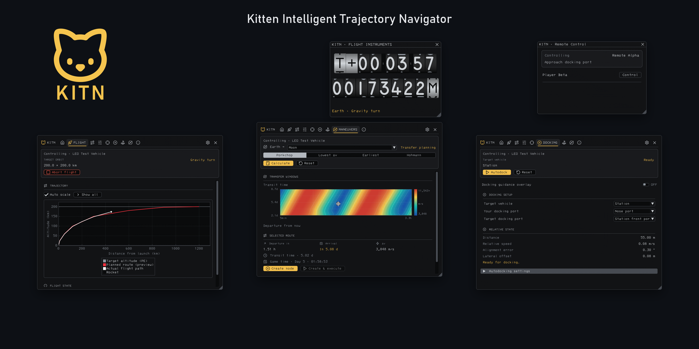

<h1 align="center">KITN</h1>

<div align="center">

[](https://github.com/steve-787/KITN/stargazers)
[](https://github.com/steve-787/KITN/blob/main/LICENSE)

</div>



An autopilot mod for Kitten Space Agency.

Pick a target orbit and press start. KITN handles ascent, circularization, transfers, docking and landing using the game's own fonts and widgets.

## Status

Active development, and it is likely buggy. The interface will change without warning. Save your game before you fly.

Prebuilt packages are on the [releases page](https://github.com/steve-787/KITN/releases). The `main` branch has the newest development code.

## Requirements

- Windows
- Kitten Space Agency, written against version 2026.11.10.5801
- The StarMap mod loader, version 0.5.4 or newer
- The .NET 10 runtime required by StarMap

## Install

Download `KITN-<version>.zip` from the [releases page](https://github.com/steve-787/KITN/releases) and extract the `KITN` folder into your game profile's `mods` folder, usually `Documents\My Games\Kitten Space Agency\mods\`. Then enable it in that profile's `manifest.toml`:

```toml
[[mods]]
id = "KITN"
enabled = true
```

Start the game through StarMap. Updating means replacing the packaged files in the same KITN folder, so keep your saved settings and presets. Each release includes a `.zip.sha256` checksum file.

To install from a source checkout instead:

```powershell
.\install.ps1
```

The script builds the project, copies the mod and licenses into the mods folder, registers KITN in `manifest.toml`, and downloads `StarMap.exe` into the game folder if it is not there yet. Pass `-KSAPath` if the game is installed elsewhere.

## Features

Start the game through `StarMap.exe`, not the normal shortcut. KITN appears only in a loaded flight with a controlled rocket, and stays hidden in the main menu and the vehicle builder.

- **Ascent:** target orbits, gravity turns, countdowns and automatic staging.
- **Transfers:** Porkchop plots, Hohmann planning and maneuver execution.
- **Rendezvous and docking:** automated approaches and port alignment.
- **Landing:** return from Earth orbit to a launch pad.
- **Widgets:** retro mission instruments and remote vessel control.
- **Customization:** presets, saved layouts and detachable desktop windows.
- **Diagnostics:** flight readouts, logs and telemetry.

Enable widgets and optional physics warp in Mod Settings. Settings and layouts are saved next to the mod DLL.

## Logs

The mod writes `kitn.log`, `kitn_telemetry.csv` and `kitn_api_dump.txt` next to the mod DLL in the mods folder. Logging and telemetry are switched in the diagnostics tab.

```powershell
Get-Content -LiteralPath "$env:USERPROFILE\Documents\My Games\Kitten Space Agency\mods\KITN\kitn.log" -Tail 40 -Wait
```

## Build

Building from source also requires the .NET 9 SDK.

```powershell
dotnet build .\KITN\KITN.csproj -c Release
```

The output is `KITN\bin\Release\net9.0\KITN.dll`. The build reads assembly references from `K:\Games\Kitten Space Agency` by default. For another installation, pass `"-p:KSAPath=C:\path\to\Kitten Space Agency"`. The StarMap API comes from NuGet and is supplied by the loader at runtime.

## Tests

```powershell
dotnet run --project .\tests\KITN.Diagnostics.Tests.csproj -c Release
```

These run without the game and without extra packages. They use their own simplified flight model, so they do not replace a test flight in the real physics.

Native UI checks need the game assemblies and the .NET 10 runtime. Build the mod in Release first, then run:

```powershell
dotnet run --project .\tests\NativeUi\KITN.NativeUi.Tests.csproj -c Release
```

They exercise all pages, the theme dropdown, countdown cancellation and dragging, and save rendered UI images under `artifacts/ui/redesign`.

Lucide 0.468.0 icons are vendored under `KITN/Assets/Icons`. To add one, include its SVG and run `python tools/build_lucide_icons.py` before building. The generated vectors and license are embedded in the DLL.

## Releasing

On GitHub, open Actions, then Release KITN, then Run workflow. Pick the default branch and choose a bump: `patch`, `minor`, `major` or `current`. The workflow updates `version.txt`, tests and builds the mod, commits the version change, tags it as `v<version>`, and publishes the ZIP and checksum as a GitHub Release. `current` publishes the version in `version.txt` unchanged.

The release guide in [docs/releasing.md](docs/releasing.md) covers the build references, the packaging step and the Borea listing.

## Layout

- `KITN/` mod sources, entry point is `KITNMain.cs`
- `tests/` diagnostics tests
- `docs/` release guide
- `tools/` packaging and icon scripts
- `install.ps1` installer and updater

## License

GPL-3.0-only. See [LICENSE](LICENSE) and [third-party notices](THIRD_PARTY_NOTICES.md).
