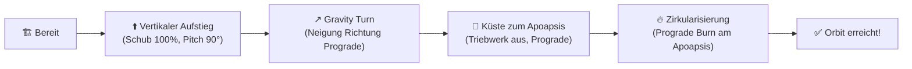

# 🚀 KSA Autopilot — Mod für Kitten Space Agency

Ein autonomer Autopilot für **Kitten Space Agency (KSA)**, der deine Rakete in den gewünschten Orbit fliegt, automatisch Stufen trennt, optionales **Hot Staging** unterstützt und das aktuell gesteuerte Fahrzeug aus dem Erdorbit zu einer ausgewählten Startrampe zurückbringt.

---

## ✨ Features

- **🚀 Vollautomatischer Start & Orbitflug:**
  - Vertikaler Aufstieg bis zur gewünschten Turn-Höhe
  - Aerodynamischer Gravity Turn
  - Automatisches Küsten bis zum Apoapsis
  - Zirkularisierungs-Burn am Apoapsis zum Anheben der Periapsis
  - Präzise Abschaltung bei Erreichen des Zielorbits

- **Automatische Rückkehr und Landung:**
  - Auswahl einer echten KSA-Startrampe im Tab **LANDING / LANDUNG**
  - Rückflugfenster, gezielter Deorbit-Burn, Wiedereintritt und angetriebener Landeanflug
  - Treibstoffprüfung einschließlich Landereserve; bestätigt die Landung über tatsächlichen Bodenkontakt
  - Steuerung wird nach Orbitabschluss und Landung freigegeben; die Missionszeit läuft weiter

- **⚡ Auto-Staging:**
  - Erkennt automatisch, wenn die aktuelle Stufe ausgebrannt ist (kein Schub mehr oder Treibstoff leer)
  - Wirft leere Seitentanks mit eigenen Triebwerken einzeln ab, auch wenn das Haupttriebwerk weiterläuft
  - Zündet zuverlässig die nächste Sequenz (`SequenceList.ActivateNextSequence`)

- **🔥 Hot Staging (konfigurierbar):**
  - Kann in der GUI ein- und ausgeschaltet werden
  - Einstellbare Resttreibstoff-Grenze (z. B. bei **5 %** Resttreibstoff der Stufe)
  - Zündet die nächste Stufe *während* die vorherige noch läuft

- **🎯 Frei konfigurierbarer Zielorbit:**
  - Standard: **LEO mit 200 km Apoapsis und 200 km Periapsis**
  - **Apoapsis (km)** und **Periapsis (km)** direkt im Flug-Fenster einstellbar
  - Live-Telemetrie (Höhe, Apoapsis, Periapsis, Geschwindigkeit, Treibstoff %, Flugphase)

- **🖥️ Native Spieloberfläche:**
  - Originale KSA-Fenster, Spielschriften und Bedienelemente über `ConsoleStyle` und `ConsoleWidgets`
  - Bereiche für Flug, Flugplan, Automatik, Diagnose und Landung mit erklärten Einstellungen
  - Echter ImPlot-Graph: rote Routenvorschau und weiße, gemessene Flugbahn
  - Countdown-Start und separate Missionsuhr im Format `T-00:00:00` / `T+00:00:00`
  - Originale rollende KSA-Höhenanzeige in der T-Anzeige; die Spielanzeige kehrt beim Schließen zurück
  - Position und Größe von Autopilot-Fenster und T-Anzeige werden automatisch gespeichert
  - Flugplan und Automatik werden während Countdown und aktivem Flug gesperrt
  - Texte und Zahlen folgen der Spielsprache; Sprachpakete können alle Mod-Texte übersetzen

---

## Flugbahn und Oberfläche

Die Mod nutzt die Fenster, Schriften, Farben und Widgets des Spiels. Die zusätzlichen Kacheln für Höhe, Geschwindigkeit, Apoapsis und Periapsis entfallen; diese Werte stehen bereits im Spiel. Im Autopilot bleiben die Zielkonfiguration, Flugphase, Flugbahn und Diagnosefunktionen.

Position und Größe des **Autopilot-Fensters** und der **T-Anzeige** werden automatisch in `ui_layout.json` neben der Mod-DLL gespeichert, sobald Verschieben oder Vergrößern für eine halbe Sekunde beendet ist. Schließen eines Fensters und Entladen der Mod speichern ausstehende Änderungen sofort. Beim nächsten Öffnen bzw. Spielstart wird das Layout wiederhergestellt. Änderungen der Spiel-UI-Skalierung werden berücksichtigt; bei einer kleineren Auflösung bleiben die Fenster auf dem Bildschirm. Die vorherige Layoutdatei bleibt als `ui_layout.json.bak` erhalten. Layoutänderungen erscheinen als `UI_LAYOUT`-Ereignisse im Log.

**Countdown starten** öffnet eine eigene Missionsuhr und beginnt standardmäßig einen Countdown von **10 Sekunden**. Die Dauer lässt sich im **Flugplan** unter **Startsequenz** von 1 bis 3.600 Sekunden einstellen. Vor dem Start zeigt die Uhr `T-HH:MM:SS`; bei null startet der Autopilot am synchronisierten Physik-Hook und die Anzeige wechselt auf `T+HH:MM:SS`. Stunden zählen über 24 hinaus weiter. Countdown und Flugzeit verwenden die Spielzeit: Pause hält beide an, Zeitraffer beschleunigt sie. Die Flugzeit läuft auch nach Erreichen des Orbits weiter.

Der Knopf **T-Anzeige** öffnet die Missionsuhr unabhängig vom Hauptfenster. Schließen der Uhr blendet sie nur aus. **Countdown abbrechen** ist im Hauptfenster und in der Uhr verfügbar und verhindert den automatischen Start. Fahrzeug- oder Körperwechsel beenden einen laufenden Countdown ebenfalls. Nach dem Start läuft T+ unabhängig von der Autopilot-Steuerung weiter: nach Orbitabschluss, Flugabbruch, Landung und beim Wechsel zum abgetrennten Booster. **Zurücksetzen**, ein neuer Countdown oder ein Rücksprung der Spielzeit beginnen eine neue Missionsuhr. Countdown-Beginn, Abbruch und Start erscheinen als `COUNTDOWN`-Ereignisse im Log.

Unter der Missionszeit sitzt die **originale rollende Höhenanzeige des Spiels**, einschließlich ihrer Ziffern, Animation und Einheit. Die Mod verwendet dafür denselben KSA-Renderer und dieselben Messwerte wie das Spiel. Solange das Instrument im T-Fenster angezeigt wird, ist seine ursprüngliche Spielanzeige ausgeblendet. Beim Schließen, bei fehlenden Fahrzeugdaten oder beim Entladen der Mod wird sie wieder freigegeben. Das gespeicherte HUD-Layout bleibt erhalten; die T+-Zeit läuft beim Schließen weiter. Registrierung, Einbindung und Freigabe erscheinen als `ALTITUDE_DISPLAY`-Ereignisse im Log.

Im Tab **Flug** zeigt der Graph die **Flughöhe in km über der Strecke ab Start in km**. Die Strecke ist die kumulierte Bewegung entlang der Planetenoberfläche, berechnet aus den CCF-Positionen. Senkrechter Aufstieg und die Rotation des Planeten zählen nicht als zusätzliche Strecke. Die weißen Messpunkte entstehen beim Autopilot-Start, etwa alle 0,25 Simulationssekunden, unabhängig von der Log-Einstellung. Nach Orbitabschluss oder Abbruch bleibt die Spur stehen; **Zurücksetzen** löscht nur die Anzeige, ein neuer Start beginnt eine neue Spur. Der Verlauf behält auch bei längeren Flügen seinen Startpunkt und bleibt auf höchstens 4.096 Punkte begrenzt.

Die **rote Route ist die berechnete Flugplanung für die aktuelle Rakete**. Vor dem Start sucht die Mod im Hintergrund bis zu 24 Turn-Verläufe und berücksichtigt Masse, Schub, Luftdruck, endliche Treibstoffvorräte, Stufenwechsel, Gravitation, Rotation, vereinfachten Luftwiderstand und verzögerte Ausrichtung. Umbauten werden anhand der tatsächlichen Brennstufenleistung erkannt, auch bei unveränderter Masse und Teilezahl. Der berechnete Turn wird an die Flugregelung übergeben; Zielorbit und gespeicherte Einstellungen bleiben erhalten. Während des Flugs berücksichtigt die Regelung den aktuellen Schub, die Masse und die radiale Bewegung, damit eine schwächere Stufe nicht zu früh waagerecht fliegt. Die rote Route bleibt ab dem Start festgehalten und die weiße Spur zeigt den gemessenen Flug. Aerodynamik und Ausrichtung bleiben Schätzungen; Hot-Staging-Überlappung und die vollständige Spielphysik werden nicht exakt simuliert.

Ein Countdown ist erst möglich, wenn eine passende Flugplanung den Zielorbit erreicht. Die Mod prüft die Rakete beim Countdown-Beginn und direkt vor der Zündung erneut. **Flug** und **Flugplan** zeigen den berechneten Turn und die geschätzte Treibstoffreserve oder einen konkreten Fehler: beispielsweise zu wenig Startschub, zu wenig Treibstoff, fehlender Flight Computer, fehlende Steuerung, eine ungültige Stufenfolge oder ein Ziel in der Atmosphäre. Ist für den benötigten Stufenwechsel Auto-Staging ausgeschaltet oder findet die Suche keine stabile Route, bleibt der Start gesperrt. Bei geänderter Rakete oder Konfiguration wird ein veralteter Plan nicht gestartet.

**Live-Skalierung** hält die ganze Route im Bild. Zum Zoomen mit dem Mausrad und Verschieben ausschalten; **Alles anzeigen** setzt die Ansicht auf den gesamten Verlauf zurück. Die graue Linie markiert die eingestellte Periapsishöhe. AP und PE werden zusätzlich als höchster und tiefster Bahnpunkt erklärt.

**Flugplan** enthält Countdown, Zielorbit und Kurveneinstellungen, **Automatik** Staging und Zeitraffer. Unter **Diagnose** stehen Steigrate, dynamischer Druck, Beschleunigung und Neigung sowie die vorhandenen Log-Optionen. Der Standard bleibt LEO mit 200 × 200 km. Die bewährte Flugregelung und der synchronisierte Physik-Hook bleiben erhalten.

Im **Flugplan** lassen sich die aktuellen Einstellungen unter **Flugvorlagen / Flight presets** speichern: Namen eingeben und **Vorlage speichern / Save preset** drücken. Die Vorlage erscheint sofort im Dropdown **Vorlage / Preset** und bleibt nach dem Spielneustart verfügbar. Bei demselben Namen wird der Button zu **Vorlage aktualisieren / Update preset**. Ein Preset enthält Zielorbit, Gravity-Turn-Höhen, Mindesttempo, Startrichtung, Kurvenform, Kipprate, Countdown sowie Staging- und Warp-Einstellungen. Die eingebaute Vorlage **Standard LEO / Default LEO** stellt den ursprünglichen Flugplan mit 200 × 200 km wieder her. Auswahl einer Vorlage aktualisiert auch die rote Routenvorschau. Während Countdown und aktivem Flug ist das Laden gesperrt; die aktuellen Einstellungen können weiterhin gespeichert werden.

Eigene Vorlagen liegen in `flight_presets.json` neben der Mod-DLL. Speichern ersetzt diese Datei erst nach vollständigem Schreiben; die vorherige Fassung bleibt als `flight_presets.json.bak` erhalten. Ungültige Kurven und leere Namen werden nicht gespeichert. Ist eine vorhandene Datei beschädigt oder nicht lesbar, wird sie erhalten und der Speichern-Button bleibt bis zum erfolgreichen **Vorlagen erneut laden / Reload presets** deaktiviert. Laden und Speichern erscheinen als `PRESET`-Ereignisse im Autopilot-Log.

## Seitentanks und Seitenbooster

Bei eingeschaltetem **Auto-Staging** prüft die Mod die radialen Decoupler der nächsten eingestellten Sequenz. Sie liest ausschließlich die Tanks und Triebwerke im jeweiligen abzutrennenden Seitenzweig. Der Füllstand der Hauptstufe und anderer Booster beeinflusst die Leer-Erkennung nicht. Bei Flüssigtriebwerken zählt der noch nutzbare Treibstoffmix: Wenn zum Beispiel der Oxidator ausgeht, verhindert übrig gebliebener Brennstoff den Abwurf nicht. Bei Feststoffboostern werden unverbrennbare Treibstoffreste abgezogen. Reine Seitenantriebe mit Thruster-Controllern werden ebenfalls berücksichtigt.

Ein gezündeter Booster muss mindestens **0,5 Sekunden Spielzeit** leer bleiben. Danach wird der zugehörige Decoupler über die normale KSA-Eingabe ausgelöst. Ein noch voller Nachbar bleibt angeschlossen, auch wenn beide Decoupler derselben Sequenz zugeordnet sind. Eine abgeschaltete, noch volle Stufe wird erhalten. Kontrollmodule, noch nicht gezündete weitere Antriebe im Seitenzweig und fehlende Treibstoffdaten verhindern den automatischen Abwurf. Die Decoupler müssen in der Stufenfolge der Rakete eingerichtet sein.

Unter `BOOSTER` protokolliert die Mod Zweig- und Decoupler-IDs, den nutzbaren Restfüllstand, Tank- und Stoffmassen, Feststoffreste, den Bestätigungszeitraum und den konkreten Halte- oder Abwurfgrund. `separation_requested` zeigt den gesendeten Befehl, `separation_confirmed` die anschließend erkannte Trennung. Die CSV enthält zusätzlich `booster_candidates`, `booster_pending_separations`, `booster_confirmed_separations` und `booster_status`.

## Automatische Landung aus dem Erdorbit

1. Wähle im Spiel den Booster oder die Trägerrakete, die landen soll. Das Fahrzeug muss in einem gebundenen Erdorbit oberhalb der Atmosphäre sein.
2. Aktiviere seine Stufe mit Flüssig-Haupttriebwerken und behalte Reservetreibstoff. Das Fahrzeug benötigt ein Kontrollmodul, einen Flugcomputer und genug Schub für die Erdgravitation. Beende einen laufenden automatischen Manöver-Burn des Spiels.
3. Öffne **LANDING / LANDUNG** und wähle den Landeplatz: **CCSFS LC-39A**, **VSFB LC-4**, **Starbase OLM A**, **GSC ELA-4** oder **Māhia LC-1A**. Die Liste kommt aus den geladenen KSA-Daten; die Mod übernimmt auch zusätzliche als Launchpad markierte Orte.
4. Drücke **Start landing / Landung starten**. Die Mod sucht ein passendes Rückflugfenster für den gewählten Ort. **Warp to return window** beschleunigt auf Wunsch die Wartezeit. Deorbit-Burn, Wiedereintritt und Landung laufen bei normaler Spielgeschwindigkeit.

Die Rückkehr steuert jeweils das **aktuell ausgewählte Fahrzeug**. Beim Wechsel zu einem anderen Fahrzeug wird sie abgebrochen und gibt die Steuerung frei. Der Aufstiegsautopilot und die Landeregelung laufen gegenseitig exklusiv. Ein Booster muss deshalb selbst den Erdorbit erreicht haben und noch nutzbaren Treibstoff besitzen. Leere, bereits auf einer suborbitalen Bahn abgeworfene Booster werden durch diesen Modus nicht geborgen. Landebeine, falls vorhanden, vor dem Aufsetzen über das Spiel ausfahren.

Die Planung berücksichtigt Erdrotation, Schwerkraft, Atmosphäre, den geschätzten Luftwiderstand und die Masse nach dem Rückflug-Burn. Zur Reserve zählen nur aktivierte, angeschlossene Tanks und der nutzbare Treibstoffmix der Haupttriebwerke. Eine Rückkehr wird erst freigegeben, wenn der geplante Deorbit-Burn und die Landereserve ins Budget passen. Die Oberfläche zeigt verfügbares Delta-v und nach der Planung den Bedarf. Bei unzureichendem Treibstoff oder keinem erreichbaren Fenster nennt sie den Grund.

Im letzten Anflug baut die Mod vertikale und seitliche Geschwindigkeit ab und hält genug Bodenfreiheit für die Ausrichtung über dem Pad. Die Radarhöhe wird um die Unterkante der tatsächlichen Fahrzeuggeometrie korrigiert. Mindestens **0,75 Sekunden bestätigter Bodenkontakt**, höchstens **1,5 m/s Oberflächengeschwindigkeit** und ein Ort innerhalb der Padfläche sind für den Abschluss erforderlich. Während dieser Bestätigung ist der Schub aus. Nach dem Aufsetzen schaltet sich die Landeregelung automatisch ab. **Abort landing / Landung abbrechen** gibt die Steuerung jederzeit frei; T+ läuft weiter.

Die neue Landefunktion wurde mit simulierten Rückflügen einschließlich endlichem Treibstoff, Triebwerks-Mindestdrosselung und verzögerter Ausrichtung sowie mit den nativen KSA-Schnittstellen, Pad-Daten, UI-Buttons und Bodenkontaktprüfungen getestet. Ein vollständiger Rückflug in der laufenden KSA-Spielphysik steht noch aus; die Luftwiderstands- und Anflugschätzungen können dafür weitere Abstimmung benötigen.

## Spielsprache

Menüs, Buttons, Hilfetexte, Graphbeschriftungen, Missionsuhr, Vorschau und Statusmeldungen verwenden den gemeinsamen Übersetzungsanbieter des Spiels (`Brutal.Localization.LStrings`). Ein Sprachwechsel aktualisiert auch bereits gespeicherte Vorschau- und Statusmeldungen. Widget-IDs, technische Log-Gründe und CSV-Spalten behalten ihre festen Namen; die Missionszeit bleibt im Format `T-00:00:00` beziehungsweise `T+00:00:00`.

Die hier installierte KSA-Version **v2026.11.10.5801** registriert in `Content/Core/Languages.xml` ausschließlich **en-US** und bietet keine separate Spracheinstellung. Deshalb startet die Mod passend zum Spiel auf Englisch. Englisch und Deutsch sind vollständig in der Mod enthalten; Deutsch wird verwendet, wenn das Spiel über ein entsprechendes Sprachpaket auf Deutsch eingestellt ist. Die Windows-Sprache bestimmt die Mod-Sprache nicht.

Zusätzliche Spiel-Sprachpakete können die registrierten Schlüssel `KSAAutopilot.<Schlüssel>` übersetzen. Alle englischen Vorlagen werden beim Mod-Start in KSA registriert und stehen damit auch dem Spielbefehl `generatelanguage` zur Verfügung. Fehlende Einträge fallen auf die vorhandene deutsche beziehungsweise englische Übersetzung zurück. Das Log dokumentiert die erkannte Sprache unter `LOCALIZATION`; die CSV enthält `game_locale`.

## Debug-Logs und Flugtelemetrie

Die Mod schreibt neben der installierten DLL nach
`C:\Users\karst\Documents\My Games\Kitten Space Agency\mods\KSAAutopilot\`:

- **`ksa_autopilot.log`**: lesbare Messwerte mit Zeitstempel, Log-Level, Kategorie sowie Flug- und Sample-Nummer. Phasenwechsel nennen ihren Auslöser; Staging protokolliert den Grund und die Sequenz vor und nach dem Aufruf. Fehler enthalten Exception-Typ, Stacktrace und Kontext.
- **`ksa_telemetry.csv`**: dieselben Messwerte als CSV, eine Zeile pro Sample. Zahlen verwenden einen Dezimalpunkt; Texte und RCS-Flags mit Kommas sind korrekt in Anführungszeichen gesetzt.
- **`ksa_api_dump.txt`**: verfügbare Steuerungs-, Positions- und Physik-Schnittstellen des installierten Spiels.

Die Telemetrie ist standardmäßig aktiv und wird alle **0,5 Sekunden Echtzeit** aufgezeichnet, auch vor dem Start und nach einem Abbruch. Phasenwechsel, Fahrzeugwechsel und Staging lösen zusätzliche Samples aus. Im Autopilot-Fenster lassen sich Aufzeichnung und CSV deaktivieren sowie das Intervall zwischen 0,1 und 5 Sekunden ändern.

| Kategorie | Aufgezeichnete Daten |
| --- | --- |
| `POSITION` | 3D-Position in CCI, CCF und ECL; Breitengrad/Längengrad in Grad; barometrische Höhe, Radarhöhe und Abstand zum Zentralkörper |
| `VELOCITY` | 3D-Geschwindigkeit, Oberflächengeschwindigkeit, vertikale/horizontale Geschwindigkeit, Flugbahnwinkel und geschätzte Beschleunigung |
| `PHYSICS` | gemessene Beschleunigung und Winkelbeschleunigung im Raketenkoordinatensystem; Drehraten; Gravitation, Luftdruck, Luftdichte, Temperatur, dynamischer Druck und Mach-Zahl |
| `ENGINE` | aktueller Schub, Gesamt-/Inert-/Treibstoffmasse, Tankfüllstand, beobachteter Throttle, Triebwerksstatus und Staging-Zustand |
| `ATTITUDE` / `CONTROL` | rohe Navball-Winkel mit Bezugsrahmen, tatsächliche Schubrichtung und Pitch, Orientierung als Quaternion, Pitch-Profil und kommandierter Pitch, Ausrichtungsfehler, gemessene Drehraten, Anstellwinkel, Haltegrund und Flugcomputer-Modi |
| `ORBIT` / `TELEMETRY` | Apoapsis/Periapsis, Zielorbit, Zeit zum Apoapsis, geplantes Δv, Brenndauer und Vorlauf, vorhergesagte Apoapsis, tangentiale Orbitgeschwindigkeit, Flugphase und Simulationszeit |
| `LANDING` | Rückflugphase, Zielpad und Koordinaten, Entfernung und vorausberechnete Abweichung, Rückflugfenster, Delta-v-Budget, Bodenfreiheit, Vertikal-/Seitentempo, Bremshöhe, Ausrichtung, Schubbedarf und Bodenkontakt |

CCI ist der zum Zentralkörper gehörende Inertialrahmen, CCF der mitrotierende Rahmen und ECL der Ekliptikrahmen des Spiels. Vektorkomponenten und Einheiten stehen in den Feldnamen (`_m`, `_m_s`, `_m_s2`, `_rad_s` usw.). `accel_fd_cci_*` wird aus zwei Geschwindigkeiten und ihrer **Simulationszeit-Differenz** berechnet; es ist der Mittelwert über das Sample-Intervall. Nach Fahrzeug-/Zentralkörperwechseln oder einem Rücksprung der Simulationszeit wird dieser Schätzer zurückgesetzt. Gemessene Körperbeschleunigung und die daraus abgeleitete Inertialbeschleunigung können daher unterschiedliche Werte zeigen.

`NaN` bedeutet, dass ein Zahlenwert aktuell nicht verfügbar oder nicht anwendbar ist. `physics_active=false` und `physics_valid=false` kennzeichnen fehlende Physiksimulation, etwa beim Warp. Die `*_valid`-Felder zeigen Lesefehler an. Die rohen Navball-Komponenten heißen `nav_angle_x_deg`, `nav_angle_y_deg` und `nav_angle_z_deg`, da ihre Euler-Reihenfolge vom Bezugsrahmen abhängt. `actual_pitch_deg` und `actual_heading_deg` werden direkt aus der Schubrichtung berechnet. `commanded_flags_seen_since_sample` sammelt manuelle Befehle; der Gravity Turn nutzt jetzt die native KSA-Zielverfolgung mit `fc_track_target=Custom`, statt manuelle Pitch-Pulse zu senden.

Log und CSV behalten beim Neustart jeweils bis zu **drei Vorgängerdateien** (`.1`, `.2`, `.3`). Beide rotieren auch ab 10 MiB; vollständige Einträge und CSV-Zeilen bleiben zusammen. Die Dateien sind während des Spiels lesbar. Messdaten gehen nur in die Dateien; Ereignisse und Fehler erscheinen zusätzlich in der Spielkonsole.

Der Installer kopiert auch `KSAAutopilot.pdb`, damit Stacktraces bei Fehlern Quelltextdateien und Zeilennummern enthalten können.

Beim Orbitabschluss steht `AUTOPILOT event=orbit_completed controls_released=true mission_clock_continues=true` im Log. Die Rückkehr protokolliert `LANDING event=target_selected`, `return_plan_ready`, ihre Phasenwechsel und `touchdown_confirmed`. `landing_active` und `autopilot_controlling` zeigen die aktuelle Steuerungsübernahme; `mission_clock_running` und `mission_elapsed_s` laufen unabhängig davon weiter. Die CSV enthält außerdem `landing_alignment_clearance_m`, `landing_descent_time_to_go_s` und `landing_command_accel_cci_*_m_s2`, um Ausrichtung, Flugprofil und Schubbefehle beim Debuggen nachzuvollziehen.

Zum Live-Mitlesen in PowerShell:

```powershell
Get-Content -LiteralPath 'C:\Users\karst\Documents\My Games\Kitten Space Agency\mods\KSAAutopilot\ksa_autopilot.log' -Tail 40 -Wait
```

CSV-Auswertung und nach einem Flug hilfreiche Filter:

```powershell
$flightRows = Import-Csv -LiteralPath 'C:\Users\karst\Documents\My Games\Kitten Space Agency\mods\KSAAutopilot\ksa_telemetry.csv'
$flightRows | Select-Object simulation_t_s, state, barometric_altitude_m, vertical_speed_m_s, live_thrust_n, actual_pitch_deg, commanded_pitch_deg, pointing_error_deg, turn_hold_reason
```

Die Diagnostik-Tests brauchen keine laufende Spielinstanz und keine zusätzlichen Testpakete:

```powershell
dotnet run --project .\tests\KSAAutopilot.Diagnostics.Tests.csproj -c Release
```

## Gravity Turn

Der Gravity Turn beginnt standardmäßig bei **2.500 m**, mindestens **125 m/s** Oberflächengeschwindigkeit und einer aufsteigenden, nahezu senkrechten Rakete. Das gewünschte Profil führt bis 65 km zur Horizontalen (Kurvenform 1,1); die Flugplanung passt Turn-Ende und Kurvenform an die aktuelle Rakete an. Der Pitch-Sollwert bewegt sich unten mit höchstens **1° pro Simulationssekunde**; von 10 bis 40 km steigt die Grenze kontinuierlich auf 3°/s. Beim Annähern an die Ziel-Apoapsis wird der Soll-Pitch weiter abgesenkt, um Horizontalgeschwindigkeit aufzubauen. Oberhalb der dichten Atmosphäre erhält eine schwächere Stufe bei Bedarf zusätzlichen Pitch, um mit ausreichender Steigrate zur Zielhöhe zu gelangen.

Die Ausrichtung wird aus dem Kontroll-/Schubrahmen und der Position im Inertialrahmen berechnet. KSA verfolgt ein benutzerdefiniertes Ziel im lokalen `EnuBody`-Rahmen mit korrekten Radiant-Werten und übernimmt Gimbal-/RCS-Regelung sowie Drehraten-Dämpfung. Die Rollachse bleibt entkoppelt. Bei mehr als 3° Ausrichtungsfehler oder zu hoher Drehrate hält der Pitch-Sollwert, bis die Rakete wieder folgt. Bei relevantem dynamischem Druck liegt der Ziel-Pitch höchstens 3° unter dem Flugbahnwinkel. Pausierte Simulation und Zeitsprünge verursachen keinen zusätzlichen Pitch-Sprung.

`pointing_error_deg`, `angle_of_attack_deg`, `turn_rate_limit_deg_s`, `turn_hold_reason` und die Flugcomputer-Felder zeigen im Log, weshalb der Turn weiterkippt oder hält. Höhe, Mindesttempo, Profilform und Kipprate sind im Autopilot-Fenster einstellbar.

Die Steuerung läuft nach `Universe.ProcessAutoWarp` und vor der Vorbereitung des nächsten Physikschritts über den StarMap-Patchservice. Zu diesem Zeitpunkt sind die alten Worker-Ergebnisse übernommen. Dadurch gelangen Lagebefehle in die nächste Physikberechnung. Start, Abbruch und Reset werden ebenfalls an diesem Zeitpunkt umgesetzt. Die Registrierung und der erste ausgeführte Aufruf erscheinen unter `CONTROL_HOOK`.

## Orbit-Einschuss und Schubbegrenzung

Der Aufstieg begrenzt den Schub anhand der vorausberechneten Apoapsis. Die Zirkularisierung startet anhand der benötigten tangentialen Geschwindigkeit und einer aus Masse, Schub und Massenstrom berechneten Brenndauer, ungefähr eine halbe Brenndauer vor der Apoapsis. Eine bestimmte Flughöhe allein löst keinen Burn aus. Ein bereits sicherer, aber zu niedriger Orbit wartet auf die nächste Apoapsis, auch wenn die Rakete gerade sinkt. Ein unsicherer suborbitaler Abstieg darf weiterhin sofort korrigiert werden. TVC-Ausrichtung während eines langen sicheren Freiflugs erfolgt erst nahe dem Brennfenster. Automatischer Zeitsprung berücksichtigt Brenndauer und Zeit zum Ausrichten.

Der Einschuss hebt zuerst die Periapsis an und bremst radiale Bewegung. Liegt das Fahrzeug etwas oberhalb der Zielhöhe, wird es während dieses Burns nicht nach unten gedrückt. Die Zielgeschwindigkeit berücksichtigt die aktuelle Flughöhe. Der Burn bleibt nach dem Passieren oder Verschieben der Apoapsis aktiv; verbleibende Geschwindigkeitsfehler bestimmen die weiteren Schubimpulse. Eine zu hohe Apoapsis beendet den unvollständigen Einschuss nicht mehr sofort: Die Schubbegrenzung erlaubt Korrekturen, die sie senken, und sperrt Impulse, die sie weiter erhöhen. Der Standard bleibt **200 / 200 km** mit derselben Obergrenze von 210 km.

Ohne ausreichendes RCS erfolgen Lagekorrekturen durch die Gimbals kurz vor dem Burn. Der Ausrichtungszustand berücksichtigt sowohl den Winkel als auch die Drehrate. Für große Lagefehler oder schnelle Drehung dauern TVC-Impulse mindestens 0,12 s, damit der Flugcomputer nach der Zündung einen angetriebenen Kontrollschritt erhält. Bei kleiner Restkorrektur und bereits ausgerichteter Rakete sind kürzere Schubimpulse möglich. Das Ziel gilt erst als erreicht, wenn **beide** Apsiden innerhalb von 1 % beziehungsweise mindestens 2 km Toleranz liegen. Ist die Periapsis gesichert, folgt bei Bedarf eine retrograde Feinkorrektur an der gegenüberliegenden Apsis. Während des Wartens verwendet diese ein inertiales Lageziel; der automatische Zeitsprung berücksichtigt auch diesen Burn. Fehlende Ausrichtung oder ein nicht näher kommender Zielorbit werden mit Abbruchgrund protokolliert.

Kleine Schubkorrekturen unterhalb der Triebwerks-Mindestdrosselung werden durch kurze Mindestschubimpulse erzeugt. Die Mod liest die Grenzen sämtlicher aktiver Triebwerkskerne: KSA kann für einen Controller 10 % melden, obwohl dessen Hauptbrennkammer auf 20 % begrenzt. `requested_average_throttle`, `commanded_throttle`, `engine_min_throttle`, `fc_reported_min_throttle` und `throttle_reason` zeigen gewünschte mittlere Leistung, gesendeten Befehl, tatsächliche Kerngrenze und gemeldete Controllergrenze. `engine_minimum_pulse_s`, `command_minimum_pulse_s` und `minimum_throttle_pulse_safe` erklären die Impulsdauer und eine gesperrte Zündung.

`insertion_mode`, `insertion_target_pitch_deg`, `insertion_radial_acceleration_demand_m_s2` und `insertion_tangential_acceleration_demand_m_s2` zeigen das aktuelle Einschussziel. `actual_orbital_thrust_pitch_deg` berücksichtigt das Vorzeichen der tangentialen Schubrichtung: 0° bedeutet Prograde, ±180° Retrograde. `insertion_transverse_rate_deg_s`, `insertion_tvc_settling` und `insertion_attitude_reason` machen das Ausdämpfen sichtbar. Die aktuellen und maximalen TVC- sowie RCS-Felder geben die Lagekontroll-Autorität als Winkelbeschleunigung in rad/s² an.

Die Tests reproduzieren verfügbare Fluglog-Zustände und die festen Einschussdaten unter `tests/Fixtures/insertion-20261112.csv`. Sie prüfen Orbitformeln, verschobene Apsiden, Brennfenster, Feinkorrekturen und Mindestschubimpulse. Die adaptive Planung wird mit der umgebauten Rakete aus den Logs, zusätzlicher Nutzlast und geringerem Schub geprüft. Der unabhängige Flugtest berücksichtigt Gravitation, Rotation, zusätzlichen Luftwiderstand, endliche Stufenleistung, fehlende RCS-Dämpfung, Mindestschubimpulse und verzögerte TVC-Ausrichtung. Auch der geloggte sichere 163-km-Orbit wird bis zur nächsten Apoapsis und zum Zielorbit simuliert. Dieser Flugtest ersetzt keinen Testflug in der vollständigen Spielphysik.

---

## 🛠️ Installation

Die Mod nutzt den **StarMap**-Modloader für Kitten Space Agency.

### Automatisierte Installation (Empfohlen)
Öffne PowerShell im Projektordner und führe aus:
```powershell
.\install.ps1
```
Das Skript:
1. Baut das Projekt (`dotnet build -c Release`)
2. Kopiert `KSAAutopilot.dll` und `mod.toml` nach `Documents\My Games\Kitten Space Agency\mods\KSAAutopilot\`
3. Trägt die Mod automatisch in deine `manifest.toml` ein
4. Richtet `StarMap.exe` und `StarMapConfig.json` in deinem KSA-Verzeichnis ein

---

## 🎮 So startest du das Spiel mit der Mod

1. Starte das Spiel über den **StarMap Loader**:
   ```
   K:\Games\Kitten Space Agency\StarMap.exe
   ```
2. Lade einen Flug oder starte ein Fahrzeug auf der Startrampe.
3. Im Spiel öffnet sich das Fenster **"KSA Autopilot"**:
   - Der Standard ist **200 km / 200 km**. Du kannst einen anderen Zielorbit einstellen.
   - Aktiviere bei Bedarf **Hot Staging** und stelle die gewünschte Fuel-% Grenze ein.
   - Klicke auf **🚀 STARTEN**.
4. Der Autopilot übernimmt Schub, Neigung und Stufentrennung bis zum stabilen Orbit!

---

## 📁 Projektstruktur

```
KSAAutopilot/
├── install.ps1                     # 1-Klick Installer & Updater
├── README.md                       # Dokumentation
└── KSAAutopilot/
    ├── KSAAutopilot.csproj         # Projektdatei mit Referenzen auf KSA & StarMap
    ├── mod.toml                    # StarMap Mod-Deskriptor
    ├── KSAAutopilotMain.cs         # Mod-Haupteinstiegspunkt & ImGui-GUI
    ├── AscentGuidance.cs           # Aufstiegslogik (Gravity Turn, Coast, Zirkularisierung)
    ├── GravityTurnController.cs    # Sanftes Pitch-Profil und Ausrichtungslimits
    ├── FlightAttitude.cs           # Raumrichtung und native KSA-Lageziele
    ├── OrbitInsertion.cs           # Orbit-, Burn- und Apoapsisberechnung
    ├── ThrottleActuator.cs         # Mindestschubimpulse und Abschaltung
    ├── StagingController.cs        # Auto-Staging & Hot-Staging Controller
    ├── FlightRecorder.cs           # Positions-, Physik- und Steuerungstelemetrie
    ├── Diag.cs                     # Kategorien, Fehlermeldungen und API-Dump
    ├── DiagnosticFile.cs           # Live-lesbare Dateien und begrenzte Rotation
    ├── TelemetryRecord.cs          # Gemeinsames Text-/CSV-Format
    └── LaunchProfile.cs            # Datenmodell für Zielorbit und Einstellungen
```

---

## 🛰️ Flugphasen


